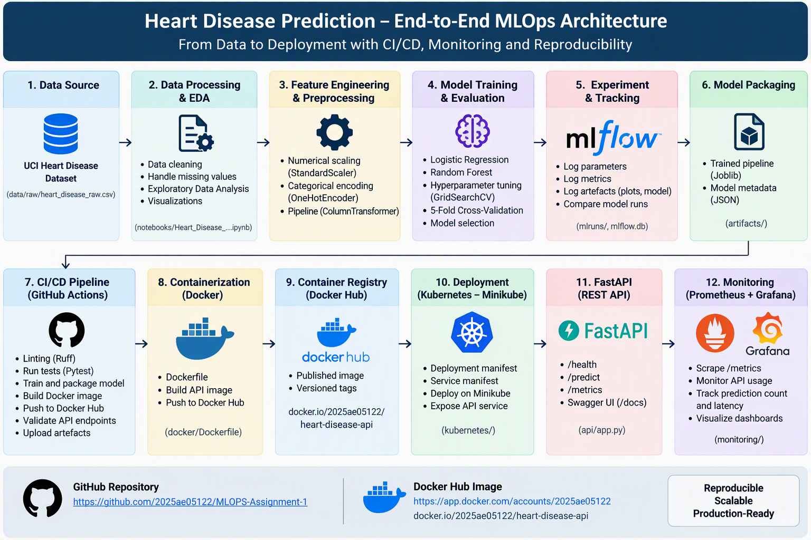

# Heart Disease Prediction: End-to-End MLOps Solution

An end-to-end MLOps project for heart-disease risk classification using the UCI Heart Disease dataset. The project covers data acquisition, EDA, reproducible preprocessing, model training, hyperparameter tuning, MLflow tracking, automated testing, CI/CD, Docker packaging, Minikube deployment, API logging and Prometheus monitoring.

> **Disclaimer:** This project is for educational use only. The model is not a validated medical diagnostic system.

## Project Links

- **GitHub repository:** [MLOPS Assignment 1](https://github.com/2025ae05122/MLOPS-Assignment-1.git)
- **Docker Hub account:** [2025ae05122 on Docker Hub](https://hub.docker.com/repositories/2025ae05122)
- **Docker image:** `docker.io/2025ae05122/heart-disease-api:latest`
- **Architecture diagram:** [`docs/heart_disease_mlops_architecture.png`](docs/heart_disease_mlops_architecture.png)
- **Final PDF report:** [`report/PROFESSIONAL_REPORT.pdf`](report/Heart_Disease_MLOps_Final_Report.pdf)
- **Demonstration video:** `ADD_VIEW_ONLY_VIDEO_LINK`

## Architecture



The solution flow is:

1. UCI Heart Disease dataset acquisition
2. Data cleaning and exploratory data analysis
3. Missing-value handling, feature encoding and scaling
4. Logistic Regression and Random Forest training
5. GridSearchCV and stratified five-fold cross-validation
6. MLflow experiment tracking
7. Reusable model-pipeline packaging
8. GitHub Actions CI/CD
9. Docker image publication to Docker Hub
10. Local Kubernetes deployment using Minikube
11. FastAPI prediction service
12. Prometheus metrics and API request logging

## Repository Structure

```text
.
├── .github/workflows/ci.yml
├── api/
├── artifacts/
├── data/
├── docker/Dockerfile
├── docs/
├── kubernetes/
├── monitoring/
├── notebooks/
├── report/
├── sample/
├── screenshots/
├── src/
├── tests/
├── KUBERNETES_DEPLOYMENT_SUMMARY.md
├── MONITORING_SETUP.md
├── pyproject.toml
└── requirements.txt
```

## Local Setup

```bash
git clone https://github.com/2025ae05122/MLOPS-Assignment-1.git
cd MLOPS-Assignment-1
python -m venv .venv
source .venv/bin/activate
pip install --upgrade pip
pip install -r requirements.txt
```

## Dataset and Training

```bash
python data/download_dataset.py
python src/train.py
```

Generated model artefacts are stored under `artifacts/`.

## Tests and Code Quality

```bash
ruff check .
pytest -v
```

## API Endpoints

| Endpoint | Purpose |
|---|---|
| `GET /` | Service information |
| `GET /health` | API and model health |
| `POST /predict` | Prediction and confidence |
| `GET /metrics` | Prometheus metrics |
| `GET /docs` | Swagger API documentation |

## Local Minikube Deployment

```bash
minikube start
minikube status
minikube update-context
kubectl config use-context minikube
kubectl apply -f kubernetes/deployment.yaml
kubectl apply -f kubernetes/service.yaml
kubectl get deployments
kubectl get pods
kubectl get services
minikube service heart-disease-api --url
```

Keep the final command running. Use the generated local URL to access `/health`, `/predict`, `/metrics` and `/docs`.

For complete deployment instructions, see [`KUBERNETES_DEPLOYMENT_SUMMARY.md`](KUBERNETES_DEPLOYMENT_SUMMARY.md).

## Monitoring and Logging

Start the monitoring stack:

```bash
docker compose -f monitoring/docker-compose.yml up -d
```

Prometheus is available at `http://localhost:9090`, and Grafana is available at `http://localhost:3000`.

The API exposes:

```text
heart_api_requests_total
heart_api_request_duration_seconds
heart_api_predictions_total
```

For complete monitoring instructions, see [`MONITORING_SETUP.md`](MONITORING_SETUP.md).

## Assignment Deliverables

- Code, Dockerfile and dependency files
- Raw/cleaned dataset and download script
- EDA, training and inference notebook/scripts
- Unit tests
- GitHub Actions workflow
- Kubernetes deployment manifests
- Screenshot evidence
- Final 10-page DOCX/PDF report
- Local Minikube API access instructions
- Short end-to-end demonstration video

## Evidence

Execution evidence is organised under:

```text
screenshots/github-actions/
screenshots/mlflow/
screenshots/docker/
screenshots/api/
screenshots/kubernetes/
screenshots/monitoring/
```
